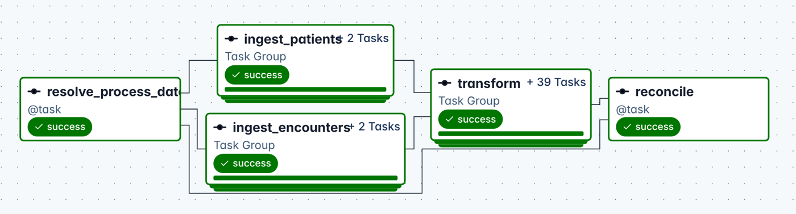
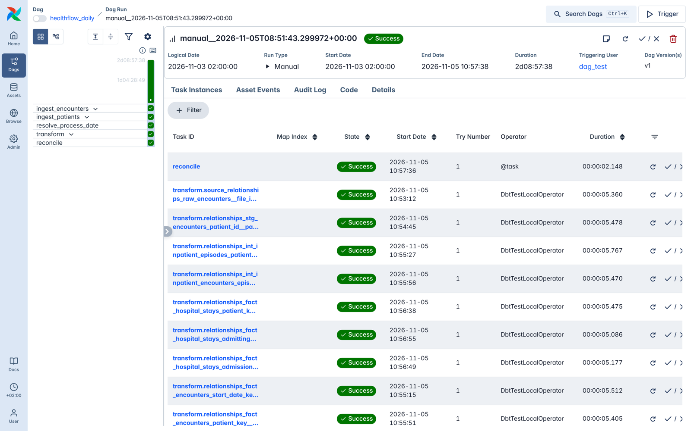

# HealthFlow — Healthcare Data Integration & Analytics Platform

[](https://github.com/obaoriekwo/healthflow-healthcare-data-platform/actions/workflows/live-demo.yml)
[](https://github.com/obaoriekwo/healthflow-healthcare-data-platform/actions/workflows/python-ci.yml)
[](https://github.com/obaoriekwo/healthflow-healthcare-data-platform/actions/workflows/dbt-ci.yml)
[](https://github.com/obaoriekwo/healthflow-healthcare-data-platform/actions/workflows/terraform-ci.yml)

### 👉 [Live demo: obaoriekwo.github.io/healthflow-healthcare-data-platform](https://obaoriekwo.github.io/healthflow-healthcare-data-platform/)

An ELT platform that turns fragmented hospital data into tested, analysis-ready models.
Python ingests daily source files into an immutable Bronze layer and a PostgreSQL warehouse;
dbt transforms them into a dimensional model with 85 data tests.

**What runs where, today:**

| | Status |
| --- | --- |
| **Live, every night** | GitHub Actions rebuilds everything on a fresh PostgreSQL: a year of history is ingested by script, then the **Airflow 3 DAG processes the final day** — ingestion, every dbt seed, model and test as its own task (Astronomer Cosmos), and cross-layer reconciliation — and the results are published. |
| **Built for local use** | A Docker Compose stack for the same DAG (Airflow 3 image with Cosmos and a separate dbt environment); Bronze through the Azure Blob API, tested against Azurite, Microsoft's storage emulator. |
| **Ready, not yet run** | Terraform for Azure (ADLS Gen2, Azure Database for PostgreSQL, Key Vault, budget alerts), validated in CI on every change. Deploying it needs an Azure subscription: [docs/azure_deployment.md](docs/azure_deployment.md). |
| **Not yet done** | Power BI report. |

The storage layer is **Azure-ready, not Azure-deployed**: the same code switches to a real
storage account with one connection string, but that has not been run against Azure yet.



<details><summary>The same run, task by task</summary>



</details>

**All data is synthetic** (generated with [Synthea](https://github.com/synthetichealth/synthea)).
No real patient data is used anywhere in this project.

## The live demo

Every night, GitHub Actions rebuilds the whole platform from an empty database and publishes the result:

1. Generates 10,000 synthetic patients with Synthea (cached weekly).
2. Simulates a year of daily deliveries from two hospital systems, with late arrivals, corrections,
   and two deliberate faults: a re-sent file with a renamed column, and a file with unusable rows.
3. Ingests every day in order, then **replays every day again** and checks that nothing changed.
4. Runs the final day through the **Airflow DAG**: ingestion, then every dbt seed, model and test as its
   own Airflow task (Cosmos), then reconciliation checks from landing files to the gold layer.
5. Publishes three pages: the [dashboard](https://obaoriekwo.github.io/healthflow-healthcare-data-platform/),
   the [pipeline status](https://obaoriekwo.github.io/healthflow-healthcare-data-platform/pipeline.html)
   (run history, deliveries, quarantine log, replay check, test results) and the
   [data model](https://obaoriekwo.github.io/healthflow-healthcare-data-platform/model.html) (star schema and data dictionary, plus the full dbt docs).

If any step or test fails, nothing is published, so the site always shows a run that passed.
Workflow: [`.github/workflows/live-demo.yml`](.github/workflows/live-demo.yml).

## Status

| Phase | Scope | Status |
| --- | --- | --- |
| 0 | Docker Compose: Airflow 3, warehouse + metadata Postgres, Azurite | ✅ |
| 1 | Simulated daily source feeds (encounters, patients), Bronze ingestion, quarantine | ✅ |
| 2 | Idempotent raw load, file and run audit | ✅ |
| 3 | dbt: staging, intermediate, star schema, KPI marts, 85 tests | ✅ |
| 4 | Airflow runs dbt (Cosmos), data tests per model, reconciliation; part of the nightly live demo | ✅ |
| 5 | GitHub Actions: Python CI, dbt CI, nightly live demo on GitHub Pages | ✅ |
| 6 | Azure + Terraform: Azure-ready, validated in CI ([guide](docs/azure_deployment.md), [why not deployed](docs/decisions.md#adr-015-healthflow-stays-azure-ready-rather-than-azure-deployed)) | 🟡 |
| 7 | Power BI + documentation | ⏳ |

## How data flows

```
Synthea CSV ──► simulator ──► landing/<source>/available_date=D/*.csv       (the "source systems")
                                     │
                         ingestion (Python, per source, per day D)
                                     │  1. skip if this delivery was already ingested
                                     │  2. header contract  ──fail──► quarantine/rejected_files/
                                     │  3. immutable copy   ────────► bronze/<source>/available_date=D/
                                     │  4. row checks       ──bad───► quarantine/invalid_records/
                                     ▼  5. one transaction: audit row + raw rows
PostgreSQL   raw_staging  ──► staging ──► intermediate ──► marts                  (dbt)
             append-only      latest       hospital stays,   dim_patient (SCD2), dim_date,
             all versions     version,     transfers merged, dim_department,
                              typed        readmission rules fact_encounters (incremental),
                                                             fact_hospital_stays, KPI marts
```

Design decisions (idempotency, three dates per record, quarantine levels, patient history,
incremental strategy, pinned versions) are in [docs/decisions.md](docs/decisions.md).
The readmission business rules are in [docs/readmission_definition.md](docs/readmission_definition.md).

## Warehouse model

| Model | Grain | Notes |
| --- | --- | --- |
| `dim_patient` | Patient version | SCD type 2 from the versions the source sent; no direct identifiers |
| `dim_date` | Day | `date_key` = YYYYMMDD |
| `dim_department` | Department | From `seeds/departments.csv` |
| `fact_encounters` | Encounter | Incremental; corrections replace earlier versions |
| `fact_hospital_stays` | Inpatient stay | Transfers merged; 30-day readmission evaluation |
| `mart_hospital_operations` | Day | Encounters, admissions, discharges, midnight census |
| `mart_emergency_department` | Day | ED volume, time in department, 4-hour measure |
| `mart_patient_readmissions` | Discharge month × department | Numerator and denominator for the readmission rate |
| `mart_department_performance` | Discharge month × department | Discharges, length of stay, critical care, deaths |

## Quick start

Needs Docker, Python 3.11+, and Java 17+ for Synthea.

```bash
cp .env.example .env                      # set WAREHOUSE_PASSWORD, and the same password in WAREHOUSE_DSN
docker compose up -d --build              # Airflow UI on http://localhost:8080

# 1. Generate synthetic patients (10,000+ for stable readmission rates; 1,000 to try it out)
scripts/generate_synthea.sh 1000

# 2. Turn the snapshot into a year of daily deliveries
pip install -r requirements-dev.txt
python -m simulator.hospital_feed --synthea-csv-dir data/synthea/output/csv \
    --from-date 2025-11-01 --to-date 2026-10-31
```

Pick dates inside Synthea's simulated history (it simulates up to the day you run it).

**3. Ingest.** Trigger the `healthflow_daily` DAG in Airflow, or use the CLI:

```bash
set -a; source .env; set +a              # export the .env settings into your shell
python -m ingestion.run init-db
python -m ingestion.run ingest --source patients   --from 2025-11-01 --to 2026-10-31
python -m ingestion.run ingest --source encounters --from 2025-11-01 --to 2026-10-31
```

Run a day twice: the second run reports `skipped=1` and adds nothing. Ingest patients before
encounters for the same day (the DAG and the CLI order above both do).

**4. Transform.** dbt runs in its own virtual environment (its dependencies clash with Airflow's):

```bash
python -m venv .dbt-venv && .dbt-venv/bin/pip install -r requirements-dbt.txt
.dbt-venv/bin/dbt build --project-dir dbt --profiles-dir dbt     # seeds, models and all tests
.dbt-venv/bin/dbt docs generate --project-dir dbt --profiles-dir dbt && \
  .dbt-venv/bin/dbt docs serve --project-dir dbt --profiles-dir dbt   # lineage graph in the browser
```

Then query `marts.*` from any Postgres client on `localhost:5433`.

## Tests

| Layer | Command | What it proves |
| --- | --- | --- |
| Python unit | `pytest` | Contracts, simulator (late arrival, corrections, de-identification), storage |
| Python integration | `HEALTHFLOW_TEST_DSN=... pytest` | Ingestion against real Postgres (table below) |
| dbt | `dbt build` | 85 data tests: keys, relationships, ranges, business rules, reconciliation |
| End to end | `HEALTHFLOW_TEST_DSN=... python scripts/check_incremental.py` | Ingest in two halves, build after each; incremental result must equal a full refresh |

Point `HEALTHFLOW_TEST_DSN` at a separate database: the tests **drop and recreate** the
HealthFlow schemas (`docker compose exec warehouse-db createdb -U healthflow healthflow_test`).
Set `HEALTHFLOW_TEST_AZURE_CONNECTION_STRING` to also test the Azure client against Azurite.

| Ingestion scenario | What the test checks |
| --- | --- |
| Rerun a day | Second run skips the file; row counts, audit rows and Bronze objects unchanged |
| Day-by-day + full replay | All days load once; replaying the range adds nothing |
| Corrections | Corrected records are new raw versions with a newer `source_updated_at` |
| Late arrival | `_available_date` is never before `_event_date`, and often after it |
| Crash mid-load | Nothing committed; Airflow retry with the same `run_id` loads everything once |
| Schema drift | Whole file quarantined with the reason; resending it is a no-op |
| Bad rows | Rejected rows quarantined with row number and reason; the rest load |
| Broken extract | Over 10% bad rows quarantines the whole file |
| Missing delivery | Run fails and is recorded as `failed` in the run audit |
| Identical empty files | Different days are separate deliveries (regression test) |
| Patient death update | Arrives as a second version of the patient |

Selected dbt business-rule tests: hospital stays never overlap; every inpatient encounter is
in exactly one stay; planned stays never count as readmissions; the readmission mart adds up
to the stay-level fact; every encounter received is in `fact_encounters` exactly once, with
its latest version.

## Repository layout

```
airflow/dags/      Airflow DAGs
ingestion/         Contracts, pipeline, storage backends, CLI
simulator/         Synthea snapshot -> daily source deliveries (encounters, patients)
sql/ddl/           Warehouse schemas, audit and raw tables (idempotent)
dbt/               Models (staging, intermediate, marts), seeds, tests, macros
scripts/           Synthea generation, incremental check, live demo pipeline and site builder
site/              Live demo page templates and assets
tests/             Python unit and integration tests
docs/              Architecture decisions, readmission definition
infrastructure/    Terraform for Azure (Phase 6)
dashboard/         Phase 7 (Power BI)
```
